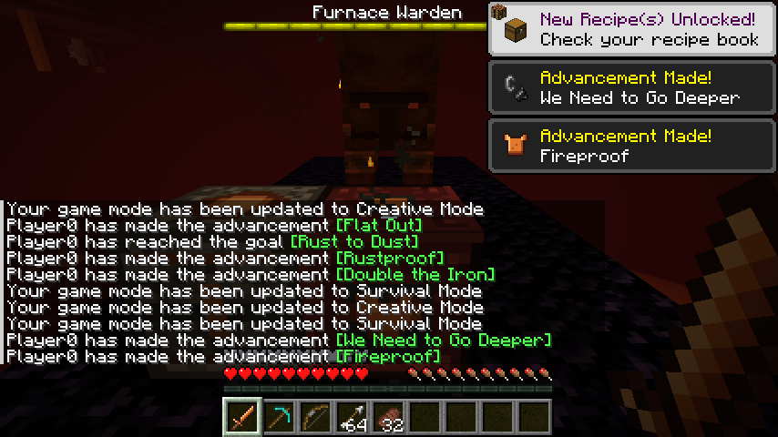
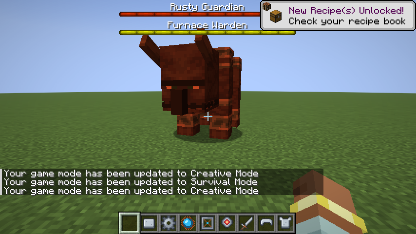
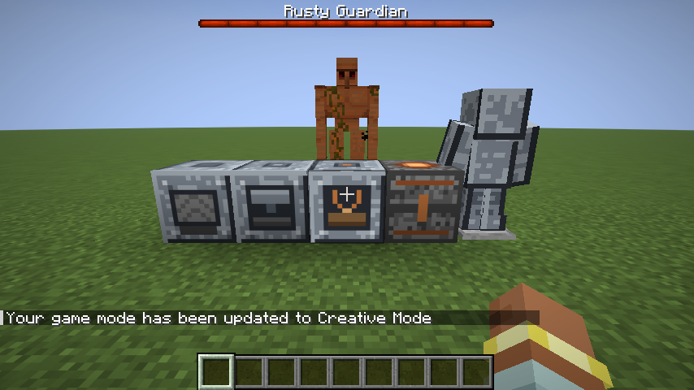

# 산업크래프트 (sanupcraft)

친구들과 같이 하는 자작 마인크래프트 모드팩. 최대 10명.
**모험대는 보스를 잡아 공장의 다음 단계를 열고, 공장은 모험대를 무장시킨다.**

```
   모험대 ── 보스 전리품 · 희귀 재료 ──▶ 공장
     ▲                                  │
     └──── 장비 · 탄약 · 이동 수단 ◀──────┘
```

- 기획: [Plans 레포 · 추천 기획 2번](https://github.com/yh-yeop/Plans) (기획 결정은 거기, 할 일은 이 레포 [ROADMAP.md](ROADMAP.md))
- 기준: **같이 할 때 재밌는지가 먼저.** 완성도 · 배포보다 플레이테스트 반응.

## 버전

| 항목 | 버전 |
|---|---|
| Minecraft (Java) | 26.3 |
| Fabric Loader | 0.20.1 |
| Fabric API | 0.165.0+26.3 |
| Java | 25 (Gradle이 자동으로 받음) |

## 게임 안 흐름 (M1)

1. **분쇄**: 분쇄기가 원석을 가루 2개로 (가끔 다른 금속 가루까지), 석탄을 석탄 가루로, 조약돌 · 자갈을 자갈 · 모래 + 너겟 · 부싯돌로. 가루는 화로에서 주괴로.
2. **합금**: 합금로가 철가루 2 + 석탄 가루 2 → **강철 주괴** (바닐라로는 못 만듦). 압착기 강철 주괴 → 강철판, 조립대 강철판 → 기계 부품.
3. **장비**: 강철 주괴로 강철 갑옷 · 검, 그리고 **강철 해머 · 굴삭 삽 (3x3 채굴)**. 기계는 화로 연료나 증기로 돈다.
3. **보스**: 수호자 제단(철판 + 철 블록 + 석재 벽돌)에 수호자 소환석(철판 + 장비 부품 + 레드스톤 블록)을 쓰면 녹슨 수호자.
   강철 한 벌이 없으면 녹 공격이 1.5배 아프고 느려진다 (내열 한 벌도 녹을 막는다). 강철 검은 1.5배.
   패턴 타격은 방패를 깨고 들어오고, 평화로움에서는 소환석이 쓰이지 않는다.
4. **다음 단계**: 수호자의 핵으로 강화 기계 틀 (M2 기계 재료).

## 게임 안 흐름 (M2)

1. **증기 동력**: 보일러(철판 + 화로 + 양동이)에 물과 연료를 넣으면 증기. 증기 파이프로 분쇄기 · 압착기 · 조립대에 이으면 연료 없이 돈다. 옆에 물 원천을 두면 물이 계속 찬다.
2. **자동화**: 강화 기계 틀로 만든 벨트 모터가 증기를 받아 컨베이어 벨트(32칸)를 돌린다. 깔때기로 벨트에 올리고, 벨트 끝의 상자 · 기계에 들어간다. 벨트 분류기(필터 9칸)는 맞는 것을 왼쪽으로 · 나머지를 앞으로 보내고, 필터 깔때기(5칸)는 맞는 것만 지나가게 한다. 원석 표지를 필터에 놓으면 원석 · 광석이 전부 맞는다.
   벨트 끝이 기계이면 석탄 같은 연료는 연료 칸으로, 나머지는 재료 칸으로 들어가고, 기계는 깔때기 · 벨트로는 자기 레시피 재료만 받는다.
   벨트 위에 아무것도 없으면 모터는 증기를 쓰지 않는다. 보일러도 증기가 쓰일 때만 연료를 태운다.
   **증기 굴착기**(강화 기계 틀 + 강철판 + 해머)가 아래 9x9를 바닥까지 캐서 위 상자 · 벨트로 보낸다. 철 곡괭이로 못 캐는 블록(흑요석 · 고대 잔해)은 남긴다.
   굴착기는 초당 5블록, 분쇄기는 5~10초에 1개라서 굴착기를 분쇄기에 바로 잇지 말고, 상자에서 원석 · 조약돌만 골라 분쇄기로 보낸다 (받지 못한 것은 벨트 끝에 쌓인다).
3. **증기 장비**: 증기 충전대(강철판 + 증기 파이프 + 기계 부품 + 깔때기)를 파이프에 이어 증기 통(철판 + 유리 + 파이프)을 올려 놓으면 증기가 채워진다 (통 하나 1000). 압착기로 철판을 눌러 리벳 4개를 만들고, **리벳총**(강철판 + 파이프 + 기계 부품)은 인벤토리의 리벳 1 + 증기 통의 증기 20으로 빠른 리벳(피해 6)을 쏜다.
   **증기 부츠**(강철 부츠 + 기계 부품 2 + 파이프, 증기 500 저장)는 공중에서 웅크리면 바라보는 쪽으로 돌진하고(증기 40), 증기가 있으면 낙하 피해가 절반이다. 증기 통 · 부츠 모두 충전대에서 채운다.
   **펌프 · 탱크**: 펌프(강철판 + 파이프 + 기계 부품 + 양동이)는 증기로 돌며 아래 반경 5 안 물 · 용암 원천을 1초에 하나씩 빨아(증기 40) 옆의 탱크 · 보일러로 보낸다. 탱크(철판 + 유리)는 한 유체를 16양동이까지 담고, 양동이로 넣고 빼고, 비교기로 찬 정도를 읽는다. 옆 보일러는 물 탱크에서 물을 끌어가고, 지열 분출구는 용암 1양동이 이상 든 탱크를 용암 원천 하나로 센다. 부숴도 내용이 아이템에 남는다.
   **기계 업그레이드**: 기계 화면 왼쪽 2칸에 속도(처리 1.5배 · 틱당 증기 · 연료도 1.5배, 핵 조각) · 효율(증기 · 연료 30% 절약, 철판 + 레드스톤) · 두 배(결과 25% 확률로 하나 더, 파수꾼의 심장)를 끼운다. 같은 것 둘이면 효과가 두 번. 깔때기 · 벨트는 업그레이드 칸을 건드리지 않는다.
4. **내열 장비**: 수호자의 핵을 분쇄기에 넣으면 핵 조각 4개. 강철 장비 + 기계 부품 + 핵 조각으로 내열 갑옷 · 검 (강철을 업그레이드, 인챈트는 사라진다).
   내열은 강철의 윗단계라서 녹 공격도 막는다. 내열 검은 공격력이 다이아 검과 같다 (7).
5. **보스 2**: 같은 제단에 파수꾼 소환석(핵 조각 + 마그마 블록)을 쓰면 용광로 파수꾼. 내열 한 벌이 없으면 과열(1.5배 + 불). 내열 검은 1.5배.
6. **다음 단계**: 파수꾼의 심장 (M3 재료).
7. **생산 · 장비 (M9a)**: **작물 수확기**(강철판 + 호미 + 기계 부품 + 파이프 + 깔때기)는 증기 파이프를 잇고 밭을 보고 놓으면 앞 9x9의 다 자란 작물을 거두고 씨앗으로 다시 심는다. **벌목기**(호미 대신 도끼)는 앞의 나무를 원목 · 잎째 통째로 베고 묘목을 다시 심는다. 둘 다 9칸에 모아 아래 상자 · 깔때기로 내보낸다.
   **증기 드릴**(곡괭이 + 삽, 다이아 등급)은 웅크리고 우클릭으로 1x1 / 3x3, **전기톱**(도끼)은 원목을 캐면 나무가 통째로 쓰러진다. 내구도 대신 증기 2000 (블록당 10), **증기 제트팩**(강철 흉갑 + 증기 통 2 + 기계 부품 2 + 파이프, 증기 3000)은 가슴 칸에 입고 점프 키를 누르고 있으면 오른다 (틱당 증기 5). 셋 다 충전대에서 채운다.

## 게임 안 흐름 (M3 · 네더 · 엔드)

바닐라 진행(철 → 네더 → 엔드)의 각 단계에서 모드가 다음 바닐라 단계로 가는 이유가 된다.

1. **장비 서열**: 철 = 강철(녹 막기) < 다이아 = 내열(불 · 용암 저항) < 네더라이트. 모드 장비는 세트 효과로 쓴다.
2. **네더로**: 파수꾼 소환석에 블레이즈 막대가 들어가고, 파수꾼은 네더 제단에서만 깨어난다. 내열 한 벌은 네더 탐험 · 고대 잔해 채굴 도구.
3. **심장 제련로**: 파수꾼의 심장으로 만든다. 고대 잔해 1 → 네더라이트 파편 2, 블레이즈 막대 1 → 가루 4 (엔더의 눈 → 엔드).
4. **엔드에서**: 셜커 껍데기로 엔더 송신기 · 수신기 (송신기에는 파수꾼의 심장 1개). 같은 염료 색끼리 차원을 넘어 아이템을 보낸다 (네더 채굴장 → 오버월드 공장). 수신기 쪽이 로드돼 있어야 한다.
5. **길잡이**: 발전 과제 "산업크래프트" 탭에 다음 할 일이 적혀 있다. 기계 · 장비 아이템에 마우스를 올리면 쓰임새 설명이 뜬다.
6. **탐험으로 만나는 보스**: 평원 · 숲의 **녹슨 사당**에는 제단과 수호자 소환석이 든 상자가 있다. 네더 요새 상자에서 파수꾼 소환석 · 핵 조각, 보루 상자에서 핵 조각이 나온다.
7. **강화 소환석**: 수호자 소환석 + 핵 조각 4개, 파수꾼 소환석 + 파수꾼의 심장 1개를 작업대에 놓으면 한 단계 강화 (+3까지). 단계마다 보스 체력 +50% · 피해 +25%, 잡으면 핵 · 심장을 하나 더 받고 기계 업그레이드도 나온다.

자세한 수치는 [ROADMAP.md](ROADMAP.md)의 M1 · M2 · M3 표. 혼자 시험하는 방법은 [docs/PLAYTEST.md](docs/PLAYTEST.md).







## 구조

모드는 jar 하나이고, 시스템은 패키지로 나눈다. 커지면 그때 모드를 쪼갠다.

| 패키지 (`io.github.yhyeop.sanupcraft.*`) | 하는 일 |
|---|---|
| `core` | 공용 아이템 · 재료 등록, 보스 전리품 ↔ 기계 레시피 연결 |
| `factory` | 기계 (분쇄기 · 합금로 · 압착기 · 조립대, 3단계 심장 제련로), 재료 2개 · 부산물 레시피, 기계 업그레이드 |
| `boss` | 보스 AI · 패턴, 던전 구조물, 전리품 |
| `power` | 보일러 · 증기 파이프 · 증기 계기판 · 증기 충전대 (2단계 동력) |
| `fluid` | 펌프 · 탱크, 유체 인터페이스 `FluidHolder` (mB 정수, 물 · 용암) |
| `logistics` | 컨베이어 벨트 · 벨트 모터 · 벨트 분류기 · 필터 깔때기, 엔더 송신기 · 수신기 |
| `gear` | 모험대 장비 (강철 · 내열), 3x3 해머 · 굴삭 삽, 증기 통 · 리벳총 · 증기 부츠 (`SteamCharge` = 아이템에 담긴 증기 도우미) |
| `mining` | 증기 굴착기 |
| `production` | 작물 수확기 · 벌목기 (M9a, 증기로 도는 9칸 보관 블록), 나무 찾기 `TreeFelling` (벌목기 · 전기톱 공용). 증기 드릴 · 전기톱 · 제트팩은 `gear` |
| `compat` | 모드팩 편의 모드 맞춤 (시체 모드) |
| `world` | 월드 구조물(녹슨 사당) · 바닐라 상자 전리품 더하기 (요새 · 보루) |
| `playtest` | `/sanupcraft playtest <단계>` 실테스트 꾸러미 |
| `server` | 10명 서버 운영: 팀(`/sanupcraft team`) · 보스 기록판 · 공용 목표판 · 설명서 (M10) |
| `production/grinder` | 몹 분쇄기(증기, 가짜 플레이어가 베어 전리품 · 경험치) · 경험치 탱크 (M9b) |
| `gear/backpack` | 배낭 27칸 · 강철 배낭 54칸, 내용은 아이템 컴포넌트 (M9b) |
| `industry` | 다중 블록 기계: 대형 보일러 (외벽 + 제어기, 보일러 코드를 물려받음) |
| `transport` | 증기 기관차 · 화물칸 · 연결 고리 · 적재 · 하역 역 |

`src/main` 공통 · 서버, `src/client` 클라이언트 전용(렌더링), `src/gametest` 자동 검사.

## 개발

JDK를 따로 깔 필요 없다. Gradle이 Java 25를 `~/.gradle/jdks`에 받아서 쓴다 (`gradle/gradle-daemon-jvm.properties`).

```bash
./gradlew build          # 컴파일 + GameTest (서버를 화면 없이 띄워 검사)
./gradlew runGameTest    # GameTest만
./gradlew runClient      # 개발용 클라이언트 실행
./gradlew runPlaytest    # 싱글 실테스트 (월드가 run/playtest에 남음, docs/PLAYTEST.md)
./gradlew runServer      # 개발용 서버 실행
./gradlew runClientGameTest  # 진짜 클라이언트를 띄워 스크린샷 (build/run/clientGameTest/screenshots/)
python tools/make_textures.py --sheet  # 임시 도트 텍스처 다시 만들기 + 미리보기
python tools/make_structures.py        # 월드 구조물(.nbt) 다시 만들기 (녹슨 사당)
SANUPCRAFT_PROMO=1 ./gradlew runClientGameTest  # 소개 페이지용 스크린샷(HUD 없이 1600x900, promo-*.png)까지 찍기
python tools/promo_crop.py build/run/clientGameTest/screenshots ../yh-yeop.github.io/assets/sanupcraft  # 사이트 이미지로
```

`runClientGameTest`는 창을 띄우므로 Actions의 `build`에는 넣지 않았다. 화면에 보이는 것을 바꿨을 때 손으로 돌린다.

### 편의 모드와 같이 시험 (충돌 확인)

모드팩에 든 편의 모드를 받아서 개발용 서버 · 클라이언트에 같이 올린다. 편의 모드 버전을 바꾸거나 릴리스하기 전에 돌린다.

```bash
python tools/make_mrpack.py build/libs/sanupcraft-0.1.0.jar 0.1.0 --download build/packmods
./gradlew runGameTest --no-configuration-cache -PpackMods=build/packmods/server      # 서버 모드와 GameTest 전부
./gradlew runClientGameTest --no-configuration-cache -PpackMods=build/packmods/all   # 전부 넣고 스크린샷 + 시체 확인
```

`-PpackMods`는 절대 경로가 안전하다 (실행 폴더가 `build/run/...`이라서). 결과는 [ROADMAP.md](ROADMAP.md)의 "충돌 확인 기록".

결과 jar는 `build/libs/sanupcraft-<버전>.jar`. GitHub Actions도 푸시마다 같은 `build`를 돌린다.

## 친구들 설치 방법

[릴리스](https://github.com/yh-yeop/sanupcraft/releases)에서 받는다.

- **플레이하는 사람**: `sanupcraft-<버전>.mrpack`을 [Modrinth App](https://modrinth.com/app) 또는 [Prism Launcher](https://prismlauncher.org/)에서 "모드팩 가져오기"로 연다. Minecraft 26.3 · Fabric · 편의 모드가 한 번에 깔린다.
- **서버 여는 사람**: [Fabric 서버](https://fabricmc.net/use/server/)(26.3)를 만들고 `mods` 폴더에 `sanupcraft-<버전>.jar`와 Fabric API를 넣는다. 시체 모드 Player Corpse도 서버에 넣는다. 음성 채팅을 쓰면 Simple Voice Chat도 넣고 UDP 24454를 연다. 서버에 필요한 모드 목록은 릴리스 본문 표의 "서버에도" 칸.

편의 모드 목록은 [tools/make_mrpack.py](tools/make_mrpack.py)의 `MODS`. 릴리스할 때 Modrinth에서 26.3 Fabric용 최신 파일을 골라 묶는다.

### 릴리스 만들기

```bash
git tag v0.2.0-beta.1 && git push origin v0.2.0-beta.1
```

`v*` 태그를 올리면 Actions가 빌드 · GameTest 후 jar · mrpack · `.sha256`을 릴리스에 올린다. 하이픈이 든 태그는 프리릴리스(테스트용). 버전은 태그에서 따온다.

## 라이선스

MIT
