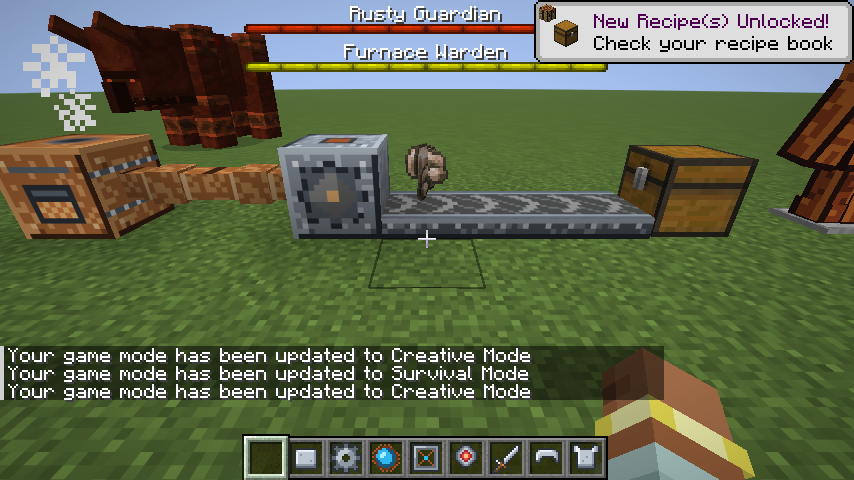

# ROADMAP

기획 결정은 [Plans 레포](https://github.com/yh-yeop/Plans)의 추천 기획 2번, 이 파일은 이 레포 안의 할 일.
역할: Claude Code는 코드 · 테스트 · 빌드, 나는 "무엇을 만들지" 결정과 친구들과 플레이 확인.

## M0 · 뼈대 (완료 2026-11-02)
- [x] Fabric 26.3 모드 뼈대 (공식 예제 기반, 모드 ID `sanupcraft`)
- [x] Java 25 자동 다운로드 (Gradle 데몬 · 툴체인)
- [x] GameTest 소스셋 + 첫 테스트(모드 로드 확인), `build`에 포함
- [x] GitHub Actions 빌드 + GameTest

## M1 · 공장 1단계 + 보스 1마리 (구현 완료 2026-11-02, 플레이테스트는 M2 뒤 싱글로)
두 축 순환이 한 바퀴 도는지만 본다.
**통과 기준:** 친구 3~4명이 한 저녁에 "공장 짓기 → 장비 → 보스 → 다음 단계 부품"을 한 번 돈다.

### 구현한 것 (초안대로)
| 항목 | 내용 |
|---|---|
| 공장 라인 | 원석 → **분쇄기**(철가루 2개) → 화로 → 주괴 → **압착기**(철판) → **조립대**(장비 부품). 원석 1개 = 장비 부품 2개 |
| 동력 | 기계마다 연료(화로 연료 아무거나). 깔때기: 위 → 재료, 옆 → 연료, 아래 ← 결과 |
| 보스 | **녹슨 수호자** 체력 300 · 방어 8. 패턴: 돌진(20틱 예고) → 내려찍기(반경 5칸, 25틱 동안 바닥에 경고 입자) → 좀벌레 3마리 소환 → 내려찍기 … 반복. 체력 절반 아래면 패턴 간격 80 → 45틱 |
| 녹 공격 | 강철 갑옷 한 벌을 다 안 입으면 보스 공격 피해 1.5배 + 구속 II 3초 (1.5단계 이후: 내열 한 벌도 인정) |
| 장비 | **강철 갑옷**(방어 19 · 단단함 1, 다이아 근처) + **강철 검**(수호자에게 피해 1.5배) |
| 소환 | **수호자 제단**에 **수호자 소환석**을 쓰면 위에 소환. 48칸 안에 한 마리만 |
| 전리품 | 수호자의 핵 1 + 철판 4~8 + 장비 부품 1~3 |
| 다음 단계 | 수호자의 핵 + 철판 + 장비 부품 → **강화 기계 틀** (M2 기계 재료) |
| 겉모습 | 아이템 · 블록 · 갑옷은 `tools/make_textures.py`로 만든 임시 도트. 기계 화면은 바닐라 화로 GUI, 보스는 철 골렘 모델 1.3배 + 녹 색칠 |

### 할 일
- [x] `core`: 재료 아이템(철가루 · 철판 · 장비 부품 · 수호자의 핵 · 강화 기계 틀) + 크리에이티브 탭
- [x] `factory`: 분쇄기 · 압착기 · 조립대 (블록 + 블록 엔티티 + 화면)
- [x] `factory`: 기계 레시피 (데이터팩 레시피 타입 `sanupcraft:crushing` · `pressing` · `assembling`)
- [x] `gear`: 강철 갑옷 · 검
- [x] `boss`: 녹슨 수호자 엔티티 + 패턴 3개 + 보스 체력바
- [x] `boss`: 소환 제단 + 소환석 + 전리품 테이블
- [x] GameTest 14개: 기계 3종 결과 · 연료 없으면 멈춤 · 처리량(원석 8개 → 철가루 16개) · 레시피 로드 · 강철 한 벌 판정 · 녹 공격 배율 · 강철 검 배율 · 보스 체력 · 제단 소환 · 졸개 소환 · 핵 드롭
- [x] 클라이언트 GameTest: 장면 · 인벤토리 · 기계 화면 스크린샷 (`./gradlew runClientGameTest`)
- [ ] **친구들과 플레이테스트** (아래 확인할 것) → 피드백을 이슈로
- [x] 테스트 릴리스 v0.1.0-beta.1: 모드 jar + mrpack(편의 모드 묶음), 태그로 자동 릴리스
- [x] 테스트 릴리스 v0.2.0-beta.1 (2026-11-05): M2 · M3 · M4 · 공장 개편 · 2단계까지
- [x] 편의 모드와 같이 실행 (자동): 서버 모드 + GameTest 16개, 전부 넣은 클라이언트 + 스크린샷 + 시체
- [ ] mrpack을 런처(Modrinth App · Prism)로 실제 설치해 월드 들어가기 (사람이)
- [ ] 멀티: 서버 + 2명 접속, 음성 채팅 연결, 보스에게 죽고 시체에서 장비 되찾기 (첫 플레이테스트 앞부분)
- [ ] 텍스처 · 모델 직접 그리기 (임시 도트 교체, 보스 전용 모델)

### 플레이테스트에서 확인할 것
- 공장 한 줄 짓는 데 얼마나 걸리나 (목표: 30~40분)
- 강철 한 벌 없이 보스를 잡을 수 있나 (잡히면 녹 배율 · 보스 체력 올리기)
- 패턴 예고가 보이고 피할 만한가 (돌진 · 내려찍기)
- 3~4명이 붙으면 너무 쉬운가 → 2단계에서 인원 배율을 넣음 (아래 "2단계")
- 역할이 나뉘나 (공장 담당 / 보스 담당)

## M2 · 증기 동력 + 컨베이어 + 보스 2 (구현 완료 2026-11-04, 싱글 플레이테스트 대기)
순환: 보스 1 → 수호자의 핵 → 벨트 모터(자동화) + 핵 조각(2단계 장비) → 보스 2 → 3단계 재료.
**통과 기준 (싱글 플레이테스트):** 혼자서 공장 1단계 → 보스 1 → 벨트 자동화 → 내열 갑옷 → 보스 2를 한 바퀴 돈다.

| 항목 | 초안 |
|---|---|
| 보일러 | 연료 + 물 → 증기. 물은 물 양동이로 붓거나 옆에 물 원천이 있으면 자동으로 찬다 |
| 증기 파이프 | 보일러와 기계를 잇는 블록. 연결된 기계에 증기를 나눠 준다 |
| 1단계 기계 + 증기 | 분쇄기 · 압착기 · 조립대에 파이프를 이으면 연료 없이 증기로 돈다 (연료도 그대로 됨) |
| 컨베이어 벨트 | 아이템을 눈에 보이게 나른다. 깔때기 · 기계가 올리고, 끝의 기계 · 상자에 넣는다. 철판 + 가죽 |
| 벨트 모터 (2단계 기계) | 강화 기계 틀로 만든다. 증기를 받아 이어진 벨트(최대 32칸)를 돌린다 |
| 핵 조각 | 분쇄기: 수호자의 핵 1 → 조각 4. 2단계 장비 재료 |
| 내열 갑옷 + 검 | 장비 부품을 많이 쓰고 핵 조각이 들어간다 (1.5단계 이후: 같은 부위 강철 장비를 재료로 올려 만든다) |
| 보스 2 · 용광로 파수꾼 | 불 속성. 패턴: 증기 분출(앞 부채꼴) · 화염 장판(바닥 불 고리) · 도약 내려찍기 |
| 과열 규칙 | 내열 갑옷 한 벌이 없으면 불이 붙고 피해 1.5배. 내열 검은 파수꾼에게 1.5배 (수호자에게도) |
| 소환 · 전리품 | 수호자 제단에 새 소환석(핵 조각). 전리품: 파수꾼의 심장 → 3단계(M3) 재료 |

### 구현한 수치
| 항목 | 내용 |
|---|---|
| 보일러 | 물 8000 · 증기 1000 저장. 타는 동안 틱마다 증기 4 (1단계 기계 4대분). 증기가 쓰일 때만 연료를 태운다 (가득 차면 쉼). 연료는 화로 연료, 우클릭 · 깔때기로 넣음. 빈손 우클릭: 상태 + 힌트 |
| 파이프 | 보일러에서 256칸까지. 20틱마다 이어진 기계를 다시 찾고 증기를 고르게 나눔 |
| 1단계 기계 | 증기 200 저장, 돌 때 틱마다 1. 증기가 있으면 연료를 안 태움 |
| 벨트 | 0.125칸/틱 (걷는 속도 절반). 아이템 · 몹 · 플레이어를 나름 (웅크리면 안 밀림). 깔때기로 한 칸에 4덩어리까지 올림. 끝의 상자 · 기계 · 깔때기에 넣음. 끝이 기계이면 연료(석탄 등)는 연료 칸 먼저, 남으면 재료 칸 / 연료가 아니면 재료 칸만 |
| 벨트 모터 | 증기 200 저장, 평균 틱당 1. 닿은 벨트부터 옆으로 이어진 32칸. 줄 위에 나를 것이 없으면 증기를 안 쓰고 쉰다 |
| 레시피 | 보일러(철판 + 화로 + 양동이), 파이프 6개(철판 + 유리), 벨트 8개(철판 + 가죽 또는 말린 다시마), 모터(강화 기계 틀 + 장비 부품 + 파이프) |
| 내열 장비 | 방어 20 · 단단함 2 (네더라이트 근처). 핵 조각: 투구 1 · 흉갑 1 · 각반 1 · 부츠 2 · 검 1 = 6개. 같은 부위 강철 장비 + 기계 부품 + 핵 조각으로 만든다 (인챈트 · 손상도는 새로 시작). 내열 한 벌은 녹 공격도 막는다. 검 공격력 7 (다이아 검과 같음) |
| 용광로 파수꾼 | 체력 450 · 방어 10. 불 · 낙하 피해 없음. 패턴 순서: 증기 분출 → 도약 → 화염 장판 → 증기 분출 → 화염 장판 → 도약. 간격 70틱, 절반 아래면 40틱 |
| 피해 | 증기 분출 10 · 화염 장판 8 · 도약 11 · 근접 10. 과열이면 1.5배 + 불 5초 |
| 소환석 | 철판 4 + 핵 조각 4 + 마그마 블록. 보스는 48칸 안에 한 마리 (수호자 · 파수꾼 통틀어) |
| 전리품 | 파수꾼의 심장 1 + 핵 조각 1~3 + 철판 6~10 |
| 겉모습 | 파수꾼은 파괴수 모델 1.2배 + 달군 쇠 색, 몸에서 불꽃 · 연기. 블록 · 아이템은 임시 도트, 벨트 윗면은 움직이는 그림 |

핵 필요량: 핵 약 8개 (강화 기계 틀 5곳 = 모터 · 굴착기 · 송신기 · 수신기 · 제련로 → 핵 5, 조각 10 = 핵 3. 내열 한 벌 6 + 파수꾼 소환석 4. 파수꾼 전리품 조각 1~3은 빼고 셈) ≈ 보스 1을 8번.



### 할 일
- [x] 보일러 · 증기 파이프 · 증기로 도는 1단계 기계
- [x] 컨베이어 벨트 · 벨트 모터
- [x] 핵 조각 · 내열 갑옷 · 내열 검
- [x] 용광로 파수꾼 (패턴 3개, 과열, 보스 체력바) · 파수꾼 소환석 · 전리품
- [x] GameTest 15개 추가 (총 31개): 보일러 증기 · 물 원천 · 파이프 연결 · 증기 분쇄기(석탄 안 씀) · 벨트로 상자까지 · 모터 없으면 멈춤 · 모터가 줄 전체를 돌림 · 깔때기 → 벨트 · 핵 → 조각 4 · 레시피 · 과열 배율 · 내열 검 배율 · 파수꾼 체력 · 불/낙하 면역 · 제단 소환 · 심장 드롭
- [x] 편의 모드 서버 4개와 같이 GameTest 31개 통과
- [x] 클라이언트 스크린샷: M2 장면 · 파수꾼
- [ ] **싱글 플레이테스트** (M1 + M2 한 바퀴)
- [ ] 패턴 판정(증기 분출 부채꼴 · 화염 장판 · 도약 착지)은 진짜 플레이어가 있어야 해서 자동 검사를 못 함 → 플레이테스트에서 확인
- [x] JEI에 기계 레시피 보이게 (2단계)

### 싱글 플레이테스트에서 확인할 것
- 공장 1단계 → 보스 1 → 벨트 자동화 → 내열 갑옷 → 보스 2까지 걸리는 시간
- 보스 1을 여러 번 잡는 게 지루하지 않은가 (지루하면 수호자 전리품에 핵 조각 추가. 핵 필요량은 위 "핵 약 8개")
- 혼자서 보스 2 패턴을 보고 피할 수 있나 (증기 분출 예고 20틱, 화염 장판 25틱)
- 벨트 · 파이프를 놓는 게 직관적인가 (벨트는 바라보는 방향으로 나름)

## M3 · 네더 · 엔드 연결 (구현 완료 2026-11-04, 싱글 실테스트 대기)
목표: 모드가 바닐라와 따로 노는 트랙이 아니라, 바닐라 진행(철 → 네더 → 엔드)의 **각 단계에서 다음 바닐라 단계로 가는 이유**가 되게 한다.

```
오버월드 (철)   공장 1단계 · 녹슨 수호자 · 강철        → 철 2배, 녹 막기
      │ 블레이즈 막대가 필요 (바닐라도 엔드 가려면 필요)
네더           파수꾼은 네더에서만 깨어남 · 내열 = 불 · 용암 저항  → 고대 잔해 캐기 도구
      │ 파수꾼의 심장 → 심장 제련로: 고대 잔해 1 → 네더라이트 파편 2, 블레이즈 막대 → 가루 4
엔드           셜커 껍데기 + 엔더 진주 → 엔더 운반기 (차원을 넘어 아이템 전송)
      └──── 네더 채굴장 · 엔드 기지 ↔ 오버월드 공장을 잇는다
```

| 연결점 | 설계 | 왜 유기적인가 |
|---|---|---|
| 장비 서열 | 철 < 강철(방어 15 = 철, 단단함 1, 녹 막기) < 다이아 ≈ 내열(방어 20, 단단함 2, 불 · 용암 저항) < 네더라이트 | 모드 장비가 바닐라 장비를 대체하지 않고 **세트 효과로** 쓸모가 생긴다. 네더라이트는 여전히 최종 |
| 파수꾼 소환석 | 마그마 블록 → **블레이즈 막대** | 블레이즈 막대는 바닐라에서도 엔드로 가는 길(엔더의 눈)에 필요한 재료. 같은 시기에 같은 곳(네더 요새)을 가게 된다 |
| 파수꾼 소환 장소 | **네더에서만** 깨어난다 (다른 곳에선 "열기가 부족하다") | 불 보스를 불의 차원에서. 네더에 기지를 차릴 이유 |
| 내열 세트 효과 | 한 벌을 입으면 화염 저항이 계속 걸림 | 내열 갑옷이 보스용 열쇠에서 **네더 탐험 · 고대 잔해 채굴 도구**가 된다 |
| 심장 제련로 (3단계 기계) | 파수꾼의 심장 + 강화 기계 틀 + 네더 벽돌로 제작. 고대 잔해 1 → 네더라이트 파편 2, 블레이즈 막대 1 → 블레이즈 가루 4 | M1 분쇄기가 철을 2배로 한 것과 짝. 네더라이트(바닐라 최종 장비)를 앞당기고, 블레이즈 가루가 늘어 엔드 가는 길(엔더의 눈)을 돕는다 |
| 엔더 운반기 | 송신기 · 수신기. 셜커 껍데기 + 엔더 진주 + 강화 기계 틀 (송신기에는 파수꾼의 심장 1개 더). 염료로 채널을 맞추면 **차원을 넘어** 아이템 전송 | 셜커 상자를 주는 엔드 도시의 재료로 공장 운반을 완성. 네더 채굴장 → 오버월드 공장. 운반기 한 쌍 = 파수꾼 2번(제련로 포함) |
| 길잡이 | 발전 과제 탭 "산업크래프트": 원석 철 → 분쇄기 → … → 엔더 운반기. 설명에 다음 할 일을 적는다 | 퀘스트 책 없이도 게임 안에서 다음 단계를 안다 |

### 싱글 실테스트 환경
- `./gradlew runPlaytest`: 지워지지 않는 월드(`run/playtest`)로 클라이언트를 띄운다. `-PpackMods`로 편의 모드도 같이.
- `/sanupcraft playtest <단계>` (OP): 그 단계에 필요한 장비 · 재료를 주고 알맞은 차원으로 보낸다. 단계: `start` · `factory` · `boss1` · `steam` · `nether` · `boss2` · `forge` · `outpost` · `end` · `home`.
- 체크리스트: [docs/PLAYTEST.md](docs/PLAYTEST.md)

### 할 일
- [x] 장비 서열: 강철 방어 19 → 15 (철과 같게), 내열 넉백 저항 제거 (다이아와 같게)
- [x] 내열 세트 효과: 화염 저항 (1초마다 다시 걸림)
- [x] 파수꾼 소환석: 마그마 블록 → 블레이즈 막대 / 파수꾼은 네더에서만 ("너무 차갑다")
- [x] 심장 제련로 (기계 4번째 종류, 증기 · 연료 둘 다): 고대 잔해 → 파편 2, 블레이즈 막대 → 가루 4
- [x] 엔더 송신기 · 수신기: 염료 채널, 차원 넘어 전송, 수신기는 9칸 상자
- [x] 발전 과제 13개 ("산업크래프트" 탭)
- [x] `/sanupcraft playtest <단계>` · `./gradlew runPlaytest` · [docs/PLAYTEST.md](docs/PLAYTEST.md)
- [x] GameTest 8개 추가 (총 39개): 내열 세트 효과 · 네더에서 파수꾼 · 제련로 2종 · 엔더 운반기(오버월드 → 네더) · 발전 과제 · 실테스트 꾸러미 · 네더 발판. 오버월드에서 파수꾼을 못 부르는 것도 검사
- [x] 편의 모드 서버 4개와 같이 GameTest 39개 통과
- [x] 클라이언트에서 실테스트 명령으로 네더 · 엔드 이동, 길잡이 탭 확인 ([네더](docs/m3-nether.png) · [엔드](docs/m3-end.png) · [길잡이](docs/m3-guide.png))
- [ ] **싱글 실테스트** (docs/PLAYTEST.md)
- [x] 보스를 월드 구조물에서 만나기 → 아래 "월드에서 보스 만나기" (2026-11-06)

## M4 · 네더 · 엔드 심화 (구현 2026-11-04, 실테스트 대기)
M3는 네더 · 엔드가 "보스 2 · 내열 · 심장 제련로 · 엔더 운반기" 하나씩으로 이어졌다. 남은 빈틈:
- 네더에서는 물을 놓을 수 없어 **보일러가 안 돈다** → 네더에 공장을 지을 수 없다 (제련로도 연료로만).
- 네더 · 엔드 자원(석영 · 네더 금 · 발광석 · 마그마 · 후렴과 · 용의 숨결)이 공장에 안 쓰인다.
- 엔더 운반기는 "수신기 쪽이 로드돼 있어야" 해서, 사람이 없는 전초기지는 멈춘다.

그래서 **네더 전초기지 → 오버월드 공장** 고리를 만든다. 각 차원이 그 차원의 방식으로 공장을 키운다.

```
오버월드   물 + 연료 → 보일러 → 증기 공장
네더       용암 원천 → 지열 분출구 → 굴착기(+ 내열 드릴: 고대 잔해) · 심장 제련로 · 분쇄기(석영 · 금)
              └ 엔더 송신기 ─ 차원을 넘어 ─→ 오버월드 수신기 → 공장
엔드       용의 숨결 · 셜커 껍데기 → 엔더 닻 ← 튀긴 후렴과(엔드에서 기름)로 10분씩
              └ 사람 없는 네더 전초기지를 계속 불러 둔다
```

| 추가 | 설계 | 왜 유기적인가 |
|---|---|---|
| 지열 증기 분출구 | 맞닿은 용암 원천마다 틱당 증기 2 (최대 4곳 = 8, 보일러 둘 몫). 물 · 연료 없음. **네더에서만** (그 밖에서는 "너무 차갑다"). 마그마 블록 5 + 핵 조각 + 증기 파이프 2 + 강화 기계 틀 | 네더의 약점(물 없음)을 네더의 강점(용암 바다)으로 바꾼다. 파수꾼처럼 "불은 불의 차원에서" |
| 내열 드릴 | 굴착기에 끼우면 다이아 곡괭이 등급: 고대 잔해 · 흑요석을 캔다. 네더라이트 파편 + 다이아 + 강철판 2 + 블레이즈 막대 | 심장 제련로(파편 2배) → 드릴 → 굴착기로 잔해 자동화. 네더 깊은 곳(Y 8~22)에 굴착기를 둘 이유. 쓰레기 버림이 네더랙 · 현무암 · 블랙스톤을 버려 잔해 · 석영 · 금만 남는다 |
| 엔더 닻 | 튀긴 후렴과 1 = 10분 동안 주변 3x3 청크를 강제 로드 (서버를 다시 켜도 이어짐). 용의 숨결 + 셜커 껍데기 2 + 엔더의 눈 + 퍼퍼 4 + 강화 기계 틀 | 엔드(드래곤 · 후렴과)가 공장의 마지막 조각: 사람이 오버월드에 있어도 네더 전초기지와 수신기가 돈다. 후렴과 농장이 공장의 일부가 된다 |
| 네더 분쇄 | 네더 석영 광석 → 석영 2 (+석영 25%), 네더 금광석 → 금가루 (+금 너겟 3개 50%), 금 박힌 블랙스톤 → 금가루 2, 발광석 → 가루 4, 석영 블록 → 석영 4, 마그마 블록 → 마그마 크림 2 (+네더랙 50%) | 바닐라보다 나은 네더 광물 처리 → 네더 공장이 오버월드에 보낼 것이 생긴다. 마그마 크림 = 화염 저항 물약 |
| 길잡이 | 발전 과제 3개: 땅의 열기(분출구, 부모 = 불씨) · 더 깊이, 더 단단하게(드릴, 부모 = 심장 제련로) · 아무도 없는 공장(닻, 부모 = 차원을 넘어) | 게임 안에서 다음 할 일 |

- 실테스트 단계 `outpost` (네더): 내열 한 벌 + 분출구 2 · 파이프 32 · 굴착기 · 드릴 · 심장 제련로 · 분쇄기 · 송신기 · 수신기 · 주황 염료 · 엔더 닻 · 튀긴 후렴과 16 · 용암 양동이 4 · 네더 광석. `end` 단계에도 엔더 닻 · 후렴과 · 용의 숨결.
- 보일러 · 분출구는 증기 분배를 `SteamOutlet` 하나로 같이 쓴다.
- 엔더 닻은 원래 강제 로드돼 있던 청크(/forceload 등)는 건드리지 않고 자기가 붙잡은 청크만 푼다. 겹치는 다른 닻이 있으면 그 닻에 넘긴다.
- GameTest 8개 추가 (총 102): 분출구(차가움 · 용암 수 · 기계 공급) · 드릴(흑요석 · 부수면 떨어짐) · 닻(청크 붙잡기 · 자기 것만 풀기 · 연료 종류) · 네더 분쇄. 클라이언트: [네더 전초기지](docs/m4-outpost.png), JEI 기계 레시피 25개.

### 실테스트에서 볼 것
- 분출구 8 증기/틱이 너무 센가 (네더 공장이 오버월드보다 쉬워지나)
- 엔더 닻 10분/후렴과가 적당한가, 3x3이 굴착기(9x9)를 덮기에 충분한가 (굴착기가 청크 경계에 걸리면 닻을 가운데에)
- ~~드릴을 끼우기 전에 지나간 층의 흑요석 · 잔해는 다시 안 본다~~ → 드릴을 끼우면 맨 위층부터 다시 훑는다 (2026-11-06)

## 공장 개편 · 실테스트 피드백 1 (구현 완료 2026-11-04, 다시 실테스트 대기)

### 받은 피드백
1. 원석 철 → 철가루 → 주괴는 의미가 없다. 바닐라 화로가 이미 원석을 주괴로 만든다.
2. 공정을 거쳐 얻는 모드 아이템의 가치가 너무 작다 (철판 · 장비 부품이 모드 레시피에만 쓰이고, 강철 장비는 철 수준).

### 기존 산업 모드에서 가져올 원칙
| 모드 | 무엇이 플레이어를 공장으로 끌어들이나 | 가져올 것 |
|---|---|---|
| Thermal · Mekanism · Create | 분쇄하면 **부산물**이 나온다 (철광석 → 철가루 + 다른 금속 확률) | 분쇄기 부산물 칸 |
| Ex Nihilo 계열 | 쓸모없는 블록(자갈 · 조약돌)이 **자원이 된다** | 조약돌 · 자갈 → 모래 · 부싯돌 · 너겟 |
| Immersive Engineering · Mekanism | 가루를 **합금**해야만 나오는 재료가 있다 (강철 = 철 + 탄소). 바닐라로는 못 만든다 | 합금로: 철가루 2 + 석탄 가루 2 → 강철 |
| Tinkers' · 여러 모드의 해머 | 결과물이 **플레이 방식을 바꾼다** (3x3 채굴) | 강철 해머 · 굴삭 삽 |
| BuildCraft 채석장 · IE 굴착기 · Mekanism 디지털 채굴기 | 공장이 **자원을 직접 캐 온다** | 증기 굴착기 (M2) |
| Mekanism 광석 처리 단계 | 단계가 오를수록 광석 배율이 오른다 (1x → 2x → 3x …) | 화로 1x → 분쇄기 2x → (다음 단계에서 3x) |

### 새 공장 흐름
```
원석 ─▶ 분쇄기 ─▶ 가루 2 + 부산물 ─▶ 화로 (1x보다 2배)
             └─▶ 철가루 2 + 석탄 가루 2 ─▶ 합금로 ─▶ 강철 주괴 ─▶ 강철 장비 · 강철 해머(3x3) · 강철판
조약돌 · 자갈 ─▶ 분쇄기 ─▶ 자갈 · 모래 + 너겟 · 부싯돌
증기 굴착기 (M2, 강화 기계 틀) ─▶ 9x9를 바닥까지 자동 채굴 ─▶ 상자 ─▶ (원석 · 조약돌만 골라) ─▶ 분쇄기
```

| 무엇 | 바뀌는 것 | 왜 가치가 있나 |
|---|---|---|
| 분쇄기 | 원석 → 가루 2 + **부산물 확률**(철 → 금가루 10%, 구리 → 금가루 10%, 금 → 구리가루 10%), 광석 블록 → 가루 3, 석탄 → 석탄 가루 2, 조약돌 → 자갈(+철 너겟 10%), 자갈 → 모래(+부싯돌 25%), 뼈 → 뼛가루 6 | 2배 + 다른 금속 + 쓰레기 블록이 자원 |
| 합금로 (새 기계, 재료 칸 2개) | 철가루 2 + 석탄 가루 2 → **강철 주괴** | 바닐라로는 못 만드는 재료. 분쇄기가 꼭 필요한 이유 |
| 강철 | 갑옷 · 검 · 해머 · 굴삭 삽은 **강철 주괴**로. 압착기: 강철 주괴 → 강철판, 조립대: 강철판 → 기계 부품 | 강철이 모든 기계 · 장비의 재료 (Mekanism 강철처럼) |
| 강철 해머 · 굴삭 삽 | 3x3 채굴 (웅크리면 1칸). 강철 곡괭이 · 삽 급 속도 | 바닐라에 없는 도구. 공장을 지을 직접적인 보상 |
| 강철 장비 수치 | 방어 15 → 17, 내구도 철의 1.5배 (다이아 아래) | 다이아 전 단계의 실속 있는 장비 + 녹 막기 |
| 증기 굴착기 (M2) | 강화 기계 틀 + 강철판 + 기계 부품. 증기로 아래 9x9를 한 층씩 바닥까지 캔다. 캔 것은 위의 상자 · 깔때기 · 벨트로 | 공장이 자원을 직접 가져온다. 굴착기는 초당 5블록이고 분쇄기는 5~10초에 1개라서, 굴착기 → 상자에서 원석 · 조약돌만 골라 분쇄기 · 합금로로 보낸다 (2단계: 쓰레기 버림이 기본으로 켜져 돌 · 흙 · 심층암 · 네더랙은 버리고 원석 · 광물만 올린다) |
| 기계 화면 | 화로 화면 대신 전용 화면: 재료 2칸(합금로) · 연료 · 결과 · 부산물 | 무엇이 어디 들어가는지 보인다 |

철판 · 장비 부품은 이름을 바꿔 정리: 철판(압착기, 철 주괴 → 철판)은 기계 외장, **기계 부품**(조립대, 강철판 → 기계 부품)은 보일러 · 모터 · 굴착기 · 소환석 · 내열 장비.

### 강철 밸런스 조정 (2026-11-04)
| | 전 | 후 | 이유 |
|---|---|---|---|
| 강철 주괴 재료 | 철가루 1 + 석탄 가루 2 (원석 철 0.5) | **철가루 2 + 석탄 가루 2 (원석 철 1)** | 철보다 싸고 좋아서 철 장비가 의미 없었음. 이제 같은 원석으로 더 좋은 장비, 대가는 석탄 · 기계 |
| 해머 · 굴삭 삽 속도 | 6.5 (곡괭이와 같음) | **3.9 (60%)** | 9칸을 한 칸 속도로 캐면 너무 셈 |
| 강철 인챈트 수치 | 12 (도구 14) | **10** (다이아와 같게) | 다이아보다 잘 붙을 이유가 없음 |
| 갑옷 방어 17 · 강도 1 · 내구도 철 1.5배 | 그대로 | | 철과 다이아 사이 |

### 구현한 것
- [x] 기계 레시피: 재료 2개 · 재료 개수 · 확률 부산물 (`ingredient2` · `count` · `byproduct`). 기계마다 전용 화면 (재료 · 둘째 재료 · 연료 · 결과 · 부산물)
- [x] 분쇄기 12종: 원석 3종(가루 2 + 다른 금속 10%), 광석 블록 3종, 석탄 · 숯 → 석탄 가루, 조약돌 → 자갈(+철 너겟 10%), 심층암 조약돌 → 자갈(+금 너겟 10%), 자갈 → 모래(+부싯돌 25%), 뼈 → 뼛가루 6
- [x] 가루 → 주괴: 철 · 구리 · 금 (화로 · 용광로)
- [x] 합금로: 철가루 2 + 석탄 가루 2 → 강철 주괴 (재료 칸 순서 상관없음, 깔때기 하나로 두 재료를 넣어도 칸이 나뉨)
- [x] 강철: 갑옷 · 검 · 해머 · 굴삭 삽은 강철 주괴로, 압착기 강철 주괴 → 강철판, 조립대 강철판 → 기계 부품 2. 강철 갑옷 방어 17
- [x] 강철 해머 · 굴삭 삽: 3x3 (바라본 면 기준, 웅크리면 한 칸, 흑요석처럼 훨씬 단단한 블록은 남김, 블록마다 내구도)
- [x] 증기 굴착기: 아래 9x9를 바닥까지, 4틱에 한 블록 (증기 8), 위 상자 · 깔때기 · 벨트로. 블록 엔티티 · 액체 · 부술 수 없는 블록은 건너뜀. 철 곡괭이로 캔 것처럼 떨어짐 (철 곡괭이로 못 캐는 흑요석 · 고대 잔해는 1.5단계부터 남김)
- [x] 길잡이: 합금(강철) · 해머 · 굴착기 단계 추가 (총 17개)
- [x] 실테스트 꾸러미: `factory`에 합금로 · 원석 구리 · 조약돌 · 자갈, `boss1`에 해머, `steam`에 굴착기
- [x] GameTest 9개 추가 (총 48개): 합금로(순서 무관 · 석탄 가루 부족하면 멈춤) · 부산물 레시피 · 석탄 가루 · 강철판 · 레시피 로드 · 해머 3x3(흑요석 남김 · 내구도) · 굴착기(증기 있으면 캐서 위 상자로 / 없으면 멈춤)
- [x] 클라이언트: 분쇄기 · 합금로 화면 ([합금로](docs/factory-alloy.png))
- [ ] 다시 실테스트 (docs/PLAYTEST.md 공장 항목)

## 월드에서 보스 만나기 (구현 2026-11-06, 실테스트 대기)
지금까지 보스는 제단을 직접 지어야만 만났다. 탐험하다가 보스로 이어지는 길을 더한다.

| 추가 | 설계 |
|---|---|
| 녹슨 사당 (오버월드 구조물) | 평원 · 해바라기 평원 · 초원 · 숲 · 자작나무 숲 · 타이가 · 사바나 · 눈 덮인 평원 · 바람 부는 언덕에 생긴다 (간격 28청크, 최소 8, 마을 4청크 밖). 9x9 무너진 석재 사당: 가운데 수호자 제단, 상자 하나 |
| 사당 상자 | 수호자 소환석 1 (항상) + 3~5개: 철판 · 장비 부품 · 철가루 · 석탄 가루 · 강철 주괴 · 철 주괴 · 빵 · 레드스톤 |
| 네더 요새 상자 | 한 풀 더: 파수꾼 소환석 20% · 핵 조각 2개 30% · 없음 50% |
| 보루 상자 (그 밖 · 다리) | 한 풀 더: 핵 조각 2개 30% · 강철 주괴 3개 20% · 없음 50% |
| 드릴 재탐색 | 내열 드릴을 끼우면 굴착기가 맨 위층부터 다시 훑어, 남겨 둔 흑요석 · 잔해도 캔다 |
| 길잡이 | 발전 과제 "옛 제단" (사당 찾기, 부모 = 루트). "불씨" 설명에 요새 상자도 적음 |

- 구조물 배치는 `tools/make_structures.py`가 `.nbt`로 만든다 (26.x 블록 상태 NBT는 `id` · `properties`).
- GameTest 6개 추가 (총 108, 리팩터링 뒤 110): 구조물 틀(제단 · 상자 전리품) · 월드 생성 등록 · 사당 상자 소환석 · 요새 상자 확률 · 보루 핵 조각 · 드릴 재탐색. 클라이언트: 일반 지형 월드에서 가장 가까운 사당을 찾아 제단까지 확인 (홍보 촬영에 포함).

### 실테스트에서 볼 것
- 사당이 너무 흔하거나 드문가 (간격 28청크), 소환석을 거저 주는 게 공장 1단계를 건너뛰게 만들지 않나 (보스는 강철 한 벌이 없으면 아프다)
- 요새 상자 20%면 공장 없이 보스 2에 너무 빨리 닿나

## 확장 계획 · A · B · C + M5 네더 심화 2 + M6 엔드 최종 (설계 2026-11-06)
뼈대: **차원마다 동력 하나, 보스 하나, 물류 하나, 이동 하나.** README 순환 그림의 빈칸(탄약 · 이동 수단)과 엔드 보스를 채운다.

| | 오버월드 | 네더 | 엔드 |
|---|---|---|---|
| 동력 | 물 증기 (보일러) | 지열 증기 → **영혼 화로 = 고압 증기** | **공허 응축기 = 고압 증기 (많이)** |
| 보스 | 녹슨 수호자 | 용광로 파수꾼 | **공허 거상** |
| 물류 | 벨트 · **분류기 · 필터 깔때기** | 엔더 송신기 | **차원 창고** |
| 이동 | **증기 부츠 (공중 돌진)** | **용암 증기선** | **증기 통으로 겉날개 가속** |
| 탐험 | 녹슨 사당 | **버려진 용광로** | **버려진 정거장** |

공통 부품: **증기 통** (아이템, 증기 0~1000 저장). **충전대** 블록(증기망에 붙음)에서 채운다. 리벳총 · 증기 부츠 · 잔해 탐지기 · 겉날개 가속이 증기 통의 증기를 쓴다 (부츠 · 탐지기는 자체 저장).

### A · 바로 쓰는 것
| # | 추가 | 설계 |
|---|---|---|
| A3 | 서버 설정 파일 | **구현 (묶음 1)**. `config/sanupcraft.json` (처음 켤 때 기본값으로 만듦). 보스 인원 배율(0.5 · 최대 3 · 기여 5%), 분출구 용암당 증기(2), 닻 연료 시간(12000) · 반경(1), 굴착기 블록당 틱(4). `/sanupcraft config reload` (OP). 값이 이상하면 그 값만 기본값 + 경고, JSON이 깨지면 전부 기본값 (파일은 덮어쓰지 않음). 새 키만 빠졌으면 읽을 때 채워 다시 씀. 값 추가법은 `config/SanupcraftConfig` 클래스 주석. 강화 소환석 배율은 C3를 만들 때 같이 넣는다 |
| A2 | 벨트 분류기 · 필터 깔때기 | **구현 (묶음 2)**. 분류기: 벨트 줄에 놓는 블록(바라보는 쪽 = 앞), 필터 9칸(유령 칸, 발사기 모양 화면). 맞는 아이템은 바라보는 쪽 기준 왼쪽으로, 나머지는 앞으로. 고른 출구가 막히면(없음 · 가득) 받는 칸에서 기다린다. 한 칸짜리 받는 칸 + 4틱마다 한 덩어리 (설정 `beltSorter.ticksPerMove`). 필터 깔때기: 바닐라 `HopperBlock`을 상속한 같은 모양 · 잠금, 5칸 짐칸을 필터로 거른다(들어오는 길 무관), 필터 5칸(깔때기 모양 화면), 8틱마다 하나 (설정 `filterHopper.ticksPerMove`). **빈 필터**: 분류기는 전부 앞으로, 깔때기는 전부 통과. 특수 필터 아이템 **원석 표지** = 원석 · 광석 태그(`c:raw_materials` · `c:ores`, Fabric 공용 태그) 전부. 레시피: 분류기 = 철판 2 · 레드스톤 · 벨트 2 · 깔때기, 필터 깔때기 = 깔때기 + 철판 + 레드스톤(무형), 원석 표지 = 철판 + 원석 철. 비교기를 안 쓴 건 네더 석영이 필요해서 |
| A1 | 증기 통 · 충전대 · 리벳 · 리벳총 · 증기 부츠 | **구현 (묶음 3)**. 증기 통 · 부츠의 증기는 데이터 컴포넌트 `sanupcraft:steam`(`gear/SteamCharge` 도우미: 읽기 · 쓰기 · 채우기 · 꺼내기, 인벤토리 통에서 합쳐 빼기 `drain`)이고, 막대(내구도 막대처럼)와 툴팁에 보인다. 충전대: 한 칸 짐칸, 파이프로 증기를 받아 안에 200까지 모으고 칸의 증기 아이템에 틱당 20(설정). 깔때기는 빈 칸에 넣기 · 가득 차면 뽑기. 리벳총 · 부츠 · 충전대 수치는 설정 파일(`rivetGun` · `steamBoots` · `steamCharger`). 부츠는 믹스인 없이 서버 틱으로 웅크림의 눌림 변화를 보고, 낙하 피해 절반은 바닐라 낙하 피해 배율 속성에 임시 -50% 보정(증기가 있는 동안)으로, 증기는 피해를 맞은 뒤(`AFTER_DAMAGE`)하트 1칸당 5. 부츠는 강철 한 벌의 신발로도 친다. 레시피: 통 = 철판 5 · 유리 · 파이프, 충전대 = 강철판 5 · 기계 부품 2 · 파이프 · 깔때기, 리벳총 = 강철판 4 · 기계 부품 · 파이프, 부츠 = 강철 부츠 · 기계 부품 2 · 파이프(무형). 원래 설계: 리벳: 압착기 철판 → 리벳 4. 리벳총: 우클릭 발사, 리벳 1 + 증기 20 (인벤토리의 증기 통에서), 피해 6, 쿨다운 10틱. 증기 부츠: 강철 부츠 방어, 증기 500 저장. 공중에서 웅크리면 바라보는 쪽으로 돌진 (증기 40, 쿨다운 20틱), 증기가 있으면 낙하 피해 절반 |
| B3 | 증기 계기판 | **구현 (묶음 1)**. 기계 · 보일러 · 분출구 · 굴착기 · 벨트 모터(`SteamStorage`)의 면에 붙이면 저장률을 비교기 신호로 (0~15, 비면 0 · 조금이라도 있으면 1 이상 · 가득이면 15). 클릭한 면이 눈금판 쪽이고 반대쪽 블록을 읽는다. 빈손 우클릭: 저장량 · 비율 · 최근 1초 들어온 양 (보일러 · 분출구는 만든 양). 레시피: 철판 4 · 유리 · 증기 파이프 · 레드스톤. 탱크(B2)는 만들 때 `SteamStorage` 대신 유체 쪽 인터페이스를 따로 둔다 |

### B · 공장 깊이
| # | 추가 | 설계 |
|---|---|---|
| B1 | 기계 업그레이드 | **구현 (묶음 4)**. 기계 화면 왼쪽 끝에 업그레이드 칸 2개 (칸 번호 5 · 6, 옛 칸 0~4는 그대로라 저장 호환). 칸마다 1개, 업그레이드만 들어가고 깔때기 · 벨트는 어느 면으로도 못 넣고 못 뺀다 (Shift 클릭은 됨). 비교기 신호는 업그레이드 칸을 세지 않는다. 속도: 틱당 진행 1.5배(소수는 다음 틱으로), 틱당 증기 · 연료도 1.5배라 한 개에 드는 양은 같다. 효율: 증기 · 연료 ×0.7. 연료는 한 개가 타는 시간을 1/(속도 × 효율)배로 바꾼다. 두 배: 업그레이드마다 따로 25% 굴려 결과 +1 (둘이면 최대 +2, 결과 칸에 자리가 없으면 덤은 버림). 수치는 설정 `machineUpgrade` (speedMultiplier · efficiencyMultiplier · doubleChance). 레시피: 속도 = 강철판 2 · 핵 조각 · 레드스톤 · 기계 부품, 효율 = 철판 4 · 레드스톤, 두 배 = 강철판 2 · 기계 부품 2 · 파수꾼의 심장. 발전 과제 "더 빨리, 더 많이" (부모 = 수호자의 핵). 원래 설계: 기계에 업그레이드 칸 2개. 속도(처리 1.5배, 증기 1.5배, 핵 조각) · 효율(증기 · 연료 30% 절약, 철판 + 레드스톤) · 두 배(결과 25% 확률로 하나 더, 파수꾼의 심장). 같은 업그레이드 둘이면 효과 두 번 (곱) |
| B2 | 펌프 · 탱크 | **구현 (묶음 4)**. 유체는 우리 인터페이스 `fluid/FluidHolder` (mB 정수, 한 칸에 한 유체, 물 · 용암; Fabric Transfer API는 안 씀). 펌프: 증기 파이프에 붙는 `SteamConsumer` · 계기판이 읽는 `SteamStorage`, 증기 200 저장. 20틱마다 증기 40으로 같은 높이 ~ 아래 5칸 · 가로 반경 5 원 안에서 바로 아래 칸에 가까운 원천 하나를 양동이처럼 떠서(블록은 없어짐, 물에 잠긴 블록은 물만 빠짐) 안에 1000 mB (최대 8000). 안의 유체와 다른 원천은 건너뛴다. 틱마다 옆의 탱크 · 보일러에 250까지 밀어 넣는다 (다른 펌프로는 안 보냄). 빈 양동이로 퍼 낼 수 있고, 밖에서 넣지는 못한다. 수치는 설정 `pump` (radius · steamPerBucket · ticksPerBucket). 탱크: 16000 mB, 물 · 용암 양동이로 붓고 빈 양동이로 퍼 냄, 비교기(계기판과 같은 계산), 빈손 우클릭 내용. 부수면 내용이 아이템 컴포넌트 `sanupcraft:fluid`로 남고(툴팁에 보임) 다시 놓으면 그대로. 탱크는 스스로 옮기지 않는다 (탱크끼리 잇기 없음). 보일러: 펌프가 밀어 넣는 물을 받고, 물 원천이 옆에 없으면 옆 물 탱크에서 틱당 100까지 끌어온다. 분출구: 용암이 1000 이상 든 옆 탱크를 원천 하나로 센다 (용암은 줄지 않는다, 최대 4곳에 포함). 레시피: 펌프 = 강철판 4 · 파이프 · 기계 부품 2 · 양동이, 탱크 = 철판 4 · 유리 4. 발전 과제 "퍼 올려라" (부모 = 보일러). 원래 설계: 펌프(증기로 돎): 아래 반경 5 안 원천을 빨아 내부 8양동이 저장, 옆 보일러(물) · 탱크로 보냄. 탱크: 한 유체 16양동이, 비교기, 양동이로 넣고 빼기. 지열 분출구는 용암이 1양동이 이상 든 탱크를 용암 원천 하나로 센다 |
| C3 | 강화 소환석 | 소환석 + 핵 조각(수호자) · 심장(파수꾼) · 공허 핵(거상)으로 +1 ~ +3. 단계마다 보스 체력 +50% · 피해 +25%, 기여자 보상 하나 더 + 업그레이드 아이템. 단계는 아이템 데이터 컴포넌트 |

### M5 · 네더 심화 2
| # | 추가 | 설계 |
|---|---|---|
| N1 | 영혼 화로 · 고압 증기 | 영혼 모래 · 영혼 흙 위에서만 도는 화로. 블레이즈 가루 1 = 고압 증기 400 (틱당 4). 물 필요 없음. 고압 증기는 **고압 파이프**로만 흐르고, 고압 기계만 받는다 |
| C2 | 정밀 조립기 · 증기 터빈 | 정밀 조립기(기계 6번째 종류, 고압 전용): 정밀 부품(강철판 + 석영 + 금가루), 최종 장비 재료. 터빈: 고압 증기 1 → 보통 증기 3 (네더 · 엔드 공장도 보통 기계를 돌린다) |
| N2 | 금 분배기 · 교역 수집판 | 분배기: 금괴 칸, 3초마다 6칸 안 어른 피글린에게 금괴를 던진다. 수집판: 반경 3 안 떨어진 아이템을 9칸에 빨아들임 (깔때기로 뺌) |
| N3 | 버려진 용광로 | 네더(현무암 삼각주 · 네더 황무지) 구조물: 부서진 심장 제련로, 수호자 제단, 상자(파수꾼 소환석 · 핵 조각 · 블레이즈 막대 · 정밀 부품 가끔) |
| N4 | 잔해 탐지기 | 손에 드는 도구, 증기 300 저장. 우클릭(증기 20): 반경 16 안 가장 가까운 고대 잔해의 방향 · 거리 (액션바 + 입자) |
| N5 | 용암 증기선 | 용암 위에 뜨는 배, 불 · 용암 면역. 내열 부품으로 만듦 |

### M6 · 엔드 최종
| # | 추가 | 설계 |
|---|---|---|
| E1 | 보스 3: 공허 거상 | 엔드에서만, 중앙 섬 밖(원점에서 500칸 이상). 체력 600 (인원 배율), 패턴: 셜커 탄 일제 사격 · 공허로 끌어당기기 · **공허 수정 4개** (살아 있는 동안 거상 무적 — 리벳총 · 활로 부숨). 기여자마다 **공허 핵**. 거상 소환석: 셜커 껍데기 + 정밀 부품 + 엔더의 눈 + 파수꾼의 심장 |
| E2 | 공허 응축기 | 엔드에서, 바로 아래가 공허(최저 높이까지 공기)일 때만. 고압 증기 틱당 8 |
| C2 | 공허 장비 | 정밀 조립기: 네더라이트 장비 + 공허 핵. 방어 · 공격은 네더라이트 + 1. 세트 효과: 공허로 떨어지면 한 번 위로 올려 줌 (쿨다운 5분) |
| E3 | 후렴 수확기 | 반경 4 안 후렴 식물을 거둬(맨 아래 남김) 9칸에. 분쇄기: 튀긴 후렴 4 → 엔더 진주 1 |
| E4 | 차원 창고 | 54칸 공용 창고, 염료 채널 (엔더 운반기처럼). 같은 채널은 어느 차원에서나 같은 내용 (월드 저장 데이터). 주인 잠금 |
| E5 | 겉날개 가속 | 겉날개로 나는 중 증기 통 우클릭 = 폭죽처럼 가속 (증기 100) |
| E6 | 버려진 정거장 | 엔드 바깥 섬 구조물: 공중 정거장 폐허, 상자(거상 소환석 재료 · 증기 통 · 셜커 껍데기) |
| E7 | 숨결 수집기 | 반경 8 안 용의 숨결 구름이 있으면 유리병 칸을 용의 숨결로 바꿈 |

### 공통
- 차원마다 실테스트 단계 추가 (`/sanupcraft playtest <단계>`), 발전 과제 (길잡이), JEI(새 기계 레시피), 한국어 · 영어, 임시 도트 (`tools/make_textures.py`), GameTest.
- 숫자는 실테스트 전 초안. 설정 파일(A3)로 뺄 수 있는 것은 뺀다.

## 1.5단계 리팩터링 · 판단이 필요한 국소 문제 (2026-11-04)
Sonnet 4기가 밸런스 · 공장 로직 · 플레이 흐름 · 보스 전투를 훑어 46건을 지적했고, Opus 판정 · 반론 · 최종 결정을 거쳐 34건을 고쳤다 (과정은 [REFACTOR.md](REFACTOR.md)).

### 바뀐 동작
- 벨트 끝이 기계이면 연료는 연료 칸 먼저, 나머지는 재료 칸. 기계는 깔때기 · 벨트로 자기 레시피 재료만 받는다 (합금로 교착 · 분쇄기가 흙에 막히던 문제).
- 보일러는 증기를 쓰는 만큼만 연료를 태운다. 용암 양동이 연료는 빈 양동이를 돌려준다.
- 벨트 모터는 줄 위에 나를 것이 없으면 쉰다. 굴착기는 철 곡괭이로 못 캐는 블록을 남긴다.
- 내열 = 강철 장비를 올려 만든다 (인챈트는 사라진다). 내열 한 벌도 녹 공격을 막는다. 내열 검 공격력 7 (다이아).
- 엔더 송신기에 파수꾼의 심장 1개.
- 보스: 돌진 · 분출 방향을 미리 잠그고 예고선을 그린다. 패턴 타격은 방패를 깨고 들어온다. 거미줄 · 구속에 안 갇힌다. 평화로움에서는 소환석이 쓰이지 않고, 위가 좁아도 쓰이지 않는다.
- 실테스트: `home` 단계(오버월드로 돌아와 "너무 차갑다" 확인), `steam` 꾸러미 보일러 2개.
- 안내: 기계 · 장비 툴팁, 기계 화면 칸 설명 · 증기 표시, 굴착기 · 보일러 · 송신기 상태 문구, 길잡이 `press`(철판 찍기) 과제.

### 2단계 (구현 2026-11-04, 실테스트 대기)
기본값은 주인 결정 전에 고른 것이다. 실테스트 뒤 숫자를 바꾸기 쉽게 상수 · 태그 한 곳에 모았다.
- **보스 인원 배율** (`boss/BossParty`): 제단에서 부를 때 48칸 안 플레이어 n명 → 체력 × min(3, 1 + 0.5(n − 1)) (2명 1.5배, 3명 2배, 5명 이상 3배). 화염 장판 = 20칸 안 플레이어마다 하나, 상한 인원수(3~6), 졸개 = 3 + (n − 1)/3. 소환한 사람에게 "n명이 함께 · 체력 ×" 안내.
- **기여자 보상**: 핵 · 심장은 전리품 표에서 빼고, 최대 체력의 5% 이상 깎은 사람 각자의 인벤토리로 준다 (가득이면 발밑). 기여자가 없으면(명령어 · 환경 피해) 보스 자리에 하나. 판 · 부품 · 조각은 전리품 표 그대로 하나.
- **굴착기 쓰레기 버림**: 태그 `sanupcraft:quarry_junk`(조약돌 · 심층암 조약돌 · 흙 · 안산암 · 섬록암 · 화강암 · 응회암 · 네더랙 · 현무암 · 엔드 돌 등)는 버린다. 기본 켜짐, 웅크리고 빈손 우클릭으로 끄기. 자갈 · 모래 · 부싯돌은 남긴다 (분쇄 재료).
- **엔더 운반기 잠금**: 놓은 사람이 주인. 웅크리고 빈손 우클릭으로 잠그면 주인 · OP만 수신기를 열고 채널을 바꾼다 (기본 열림, 자동 운반은 그대로). 채널 자체는 여전히 서버 공용 16색.
- **JEI 연동** (`client/jei`): 분쇄기 · 압착기 · 합금로 · 조립대 · 심장 제련로 화면 (재료 → 결과 · 부산물 확률 · 처리 시간). 싱글은 서버 레시피, 멀티는 모드 jar의 레시피 JSON을 읽는다 (서버 데이터팩 변경은 멀티에서 안 보임).

### 아직 결정하지 못한 것 (실테스트 뒤)
- 채널 소유 모델 (지금: 서버 공용 + 잠금). 개인 · 팀 채널이 필요한지
- 인원 배율 숫자(0.5 · 최대 3배 · 5%)가 맞는지
- 파수꾼의 심장의 두 번째 용도, 전멸하면 보스 회복할지
- 실테스트 필수: 기둥 위에서 활로만 잡히는 보스(반격 패턴 필요?), 방치된 보스 때문에 제단이 계속 "근처에 보스가 있다"가 되는 상황
- 실테스트 항목: 조약돌 → 철 너겟 10%가 많은가(많으면 낮추기), 해머 3x3 처리량(속도 60%여도 5.4배)

## 충돌 확인 기록

### 2026-11-04 · 편의 모드 11개 (v0.1.0-beta.1 목록 + Player Corpse 1.1.0)
- **서버** (Lithium · FerriteCore · Simple Voice Chat · Corpse Graves): GameTest 16개 통과. Lithium이 깔때기 동작을 바꾸므로 깔때기로 분쇄기를 돌리는 테스트를 새로 넣었고 통과.
- **클라이언트** (11개 전부, Sodium 켜짐): 기계 · 보스(색 · 금 · 체력바) · 강철 갑옷 · 아이템 아이콘 · 기계 화면이 정상으로 그려짐. JEI 목록, Xaero 미니맵(죽은 자리 웨이포인트 포함), 음성 채팅 안내가 함께 뜸.
- **시체**: 강철 갑옷을 입고 죽으면 아이템 18칸이 전부 시체에 들어가고, 시체 · 홀로그램(남은 시간 · 보호 시간)이 생김.
  Corpse Graves 기본 설정이 `displayArmor: false`라서 시체가 갑옷 없이 보였다.

### 2026-11-04 · 시체에 갑옷 보이게
- Corpse Graves 1.1.0은 설정을 읽을 때마다(시작 · `/corpsegraves reload`) 옛 설정 옮기기 코드가 돌아 `displayArmor`를 false로 되돌린다.
  옛 키 `onlyOwnerCanLoot`가 없으면 실행되는데 그 키를 스스로 쓰지 않아서 매번 돈다. 그래서 설정 파일을 같이 배포해도 유지되지 않는다.
- 우리 모드에 `compat/CorpseGravesCompat`를 넣어 Corpse Graves가 있으면 서버에서 1초마다 `displayArmor`를 다시 켠다. 서버 관리자가 따로 할 일 없음.
- 확인: 편의 모드 11개를 넣은 클라이언트 테스트에서 강철 갑옷 네 부위가 시체에 입혀진 채 보임 ([스크린샷](docs/corpse-armor.png)). 테스트가 이제 이걸 검사한다.
- Corpse Graves가 이 문제를 고치면 이 우회는 지워도 된다.
- **로그**: Mixin 적용 실패 없음, 우리 모드 오류 · 경고 없음. 남은 경고는 개발 환경용 refmap 안내, 오프라인 계정, Sodium의 그래픽 드라이버 우회뿐.
- **못 본 것**: 런처로 실제 설치(파일 받기 · 해시), 두 명 이상 멀티, 음성 채팅 실제 연결.
- **JEI**: 제작대 레시피만 보이고 분쇄기 · 압착기 · 조립대 레시피는 안 보인다 → 2단계에서 JEI 연동 추가 (클라이언트 시험 로그: 기계 레시피 19개 등록).

## 정한 것
- 2026-11-04 · 서버는 서버 컴에서 따로 돌린다 (Fabric 전용 서버)
- 2026-11-04 · 순서: M2를 먼저 하고, 플레이테스트는 싱글로 (M1 + M2를 한 번에)

## 아직 정하지 않은 것 (Plans에서 넘어옴)
- 퀘스트 책을 넣을지
- 가져다 쓸 편의 모드: 성능 최적화 · 지도 · 음성 채팅 (26.3 지원 확인 필요)
